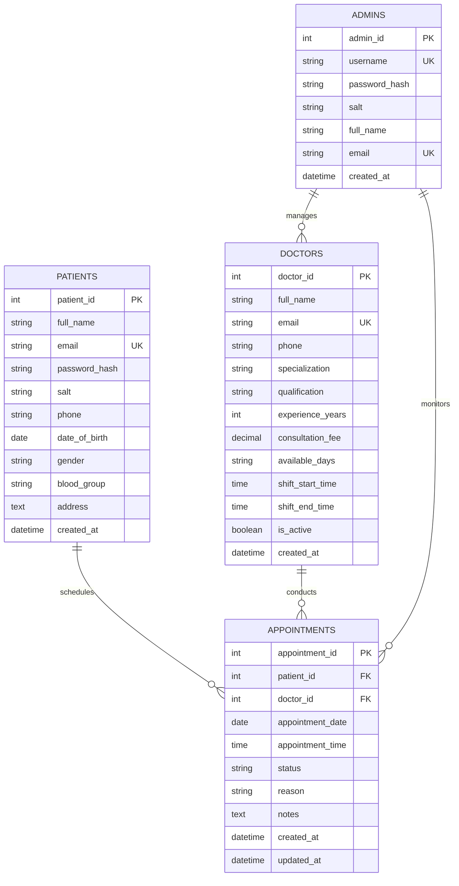

# Healthcare Appointment Management System

> A production-grade, layered Java desktop application for patient self-service scheduling, doctor directory management, and administrative healthcare operations. Built with pure Java, JDBC, MySQL, and Java Swing.

[](https://openjdk.org/)
[](https://www.mysql.com/)
[](https://docs.oracle.com/javase/tutorial/jdbc/)
[](https://www.formdev.com/flatlaf/)

---

## 1. Project Overview & Motivation

This project was built from the ground up without heavy abstractions (such as Spring Boot or Hibernate) to showcase core computer science and software engineering competencies:
- **Object-Oriented Design (OOP)**: Deep use of abstraction, inheritance, polymorphism, and encapsulation.
- **Relational Modeling & Normalization**: 3NF database schema with foreign key cascades, soft-deletes, and indexing.
- **Defensive JDBC Engineering**: Parametrized queries (`PreparedStatement`) eliminating SQL injection, transactional isolation, and leak-free resource pooling.
- **Enterprise Security**: Cryptographic salt generation via `SecureRandom` and SHA-256 password hashing.
- **Modern Desktop UI**: Java Swing styled with the FlatLaf design system.

---

## 2. Technology Stack

| Component | Technology | Rationale |
| :--- | :--- | :--- |
| **Language** | Java 17+ (Compatible with Java 21 & 25) | Strong typing, modern date/time APIs (`java.time`), multi-threading safety. |
| **Database** | MySQL 8.0+ | ACID transactions, foreign key constraints, composite index optimizations. |
| **Data Connectivity** | JDBC (`mysql-connector-j`) | Direct SQL control, connection pooling, zero overhead. |
| **Frontend UI** | Java Swing + FlatLaf 3.4 | Native cross-platform desktop UI with modern typography and styling. |
| **Build & Dependency Tool** | Apache Maven | Automated dependency resolution and lifecycle packaging. |
| **Development Environment** | IntelliJ IDEA | Industry-standard Java IDE. |
| **Version Control** | Git & GitHub | Modular commits, gitignore safety for credentials. |

---

## 3. Core Features & Capabilities

### 🩺 A. Patient Management
- **Registration**: Client and server-validated sign-up (Email, Phone, Date of Birth, Gender, Blood Group, Address).
- **Secure Authentication**: Salted SHA-256 credential verification.
- **Self-Service Booking**:
  - Filter active doctors by specialization.
  - Interactive doctor fees, qualifications, and clinic working hours.
  - **Dynamic 30-Minute Slot Generator**: Auto-calculates available timeslots, automatically filtering out already booked hours and past times.
- **Appointment History**: Live `JTable` displaying consultation status (`CONFIRMED`, `PENDING`, `COMPLETED`, `CANCELLED`).
- **Cancellation**: One-click cancellation with ownership verification (patients can only cancel their own appointments).
- **Profile Management**: Update contact information, address, and demographics.

### 👨‍⚕️ B. Doctor Directory Management
- **Practitioner Registry**: Full credentials, qualifications, specialization, years of experience, and consultation fees.
- **Shift & Working Day Management**: Strict definition of operating weekdays (e.g. `Monday,Wednesday,Friday`) and shift hours (`09:00 - 17:00`).
- **Soft-Delete Architecture**: Inactivating a doctor sets `is_active = 0`, preserving historical appointment records without foreign key violations.

### 📅 C. Appointment Scheduling & Collision Prevention
- **Two-Tier Double-Booking Prevention**:
  1. **Database Tier**: Composite index on `(doctor_id, appointment_date, appointment_time, status)`.
  2. **Service Tier**: Real-time slot collision detection (`DuplicateBookingException`).
- **Lifecycle Tracking**: `PENDING` ➔ `CONFIRMED` ➔ `COMPLETED` / `CANCELLED`.
- **Validation Rules**: Past-date booking prevention, working day verification, shift hour boundaries.

### 🛡️ D. Administrator Console
- **Executive KPI Dashboard**: Real-time summary cards (Active Doctors, Registered Patients, Total Appointments).
- **Doctor CRUD**: Add new medical staff, update profiles/fees, and deactivate retiring practitioners.
- **Global Appointment Monitor**: Filter appointments by status (`CONFIRMED`, `COMPLETED`, `CANCELLED`) and update appointment statuses with administrative notes.
- **Patient Registry**: Global patient audit table.

---

## 4. Layered Software Architecture

```
┌─────────────────────────────────────────────────────────────┐
│                 PRESENTATION LAYER (UI)                     │
│    LoginFrame, RegisterFrame, PatientDashboardFrame,         │
│    AdminDashboardFrame, DoctorDialog, UIUtils               │
└──────────────────────────────┬──────────────────────────────┘
                               │ Invokes
                               ▼
┌─────────────────────────────────────────────────────────────┐
│                 SERVICE LAYER (Business Logic)              │
│    AuthService, DoctorService, AppointmentService,          │
│    PatientService, PasswordUtils, ValidationUtils           │
└──────────────────────────────┬──────────────────────────────┘
                               │ Calls
                               ▼
┌─────────────────────────────────────────────────────────────┐
│                 DATA ACCESS LAYER (DAO)                     │
│    IPatientDAO, IDoctorDAO, IAdminDAO, IAppointmentDAO      │
│    (Implementations using JDBC PreparedStatements)          │
└──────────────────────────────┬──────────────────────────────┘
                               │ TCP / JDBC
                               ▼
┌─────────────────────────────────────────────────────────────┐
│                 DATABASE LAYER (MySQL 8.0)                  │
│    Tables: admins, patients, doctors, appointments          │
└─────────────────────────────────────────────────────────────┘
```

---

## 5. Database Schema & ER Diagram



---

## 6. Pre-Configured Test Credentials

When `schema.sql` is imported, the database is pre-seeded with realistic test accounts:

| Role | Username / Email | Password | Description |
| :--- | :--- | :--- | :--- |
| **Administrator** | `admin` / `admin@healthcare.com` | `Admin@123` | System Administrator with full console rights |
| **Patient 1** | `john.doe@example.com` | `Patient@123` | John Doe, 38, Male, O+ (Has 2 existing appointments) |
| **Patient 2** | `alice.smith@example.com` | `Patient@123` | Alice Smith, 33, Female, A+ (Has 2 existing appointments) |
| **Doctors** | Pre-seeded with 6 doctors across Cardiology, Dermatology, Neurology, Pediatrics, Orthopedics, General Medicine |

---

## 7. Installation & Execution Guide

### Prerequisites
1. **Java JDK 17 or higher** installed (`java -version`).
2. **MySQL Server 8.0+** running locally on port `3306`.
3. **IntelliJ IDEA** (Community or Ultimate edition).

### Step 1: Clone Repository
```bash
git clone https://github.com/your-username/healthcare-appointment-system.git
cd healthcare-appointment-system
```

### Step 2: Set Up the MySQL Database
1. Open your MySQL client (MySQL Workbench, HeidiSQL, DBeaver, or command line).
2. Execute the included [schema.sql](schema.sql) script:
   ```bash
   mysql -u root -p < schema.sql
   ```
   *This automatically creates `healthcare_db`, sets up all 4 tables with constraints, and populates the sample seed data.*

### Step 3: Configure Database Credentials
Open `src/main/resources/db.properties` and verify your local MySQL username and password:
```properties
db.url=jdbc:mysql://localhost:3306/healthcare_db?useSSL=false&allowPublicKeyRetrieval=true&serverTimezone=UTC&characterEncoding=UTF-8
db.user=root
db.password=your_mysql_password
```

### Step 4: Open and Run in IntelliJ IDEA
1. Open **IntelliJ IDEA**.
2. Click **File** ➔ **Open...** and select the `HealthcareAppointmentSystem` folder.
3. IntelliJ will automatically detect `pom.xml` and download the MySQL connector and FlatLaf dependencies in the background.
4. Locate `src/main/java/com/healthcare/Main.java`.
5. Right-click `Main.java` and select **Run 'Main.main()'** (or click the green **▶** arrow).

---

## 8. Automated Integration Test Harness

The system includes a comprehensive integration test suite verifying all 8 core technical scenarios:

```bash
# Locate and run via IntelliJ IDEA:
src/main/java/com/healthcare/test/SystemIntegrationTest.java
```

### Scenarios Verified:
1. `PasswordUtils`: Salt generation and SHA-256 verification.
2. `ValidationUtils`: Email, phone, and past/future date validation.
3. `UserSession`: Thread-safe session management & RBAC checks.
4. `AuthService`: Patient registration with unique email enforcement.
5. `AuthService`: Invalid login credentials rejection.
6. `AppointmentService`: Successful booking workflow.
7. `AppointmentService`: **Duplicate booking collision prevention**.
8. `AppointmentService`: Unauthorized cancellation attempt rejection.

---
